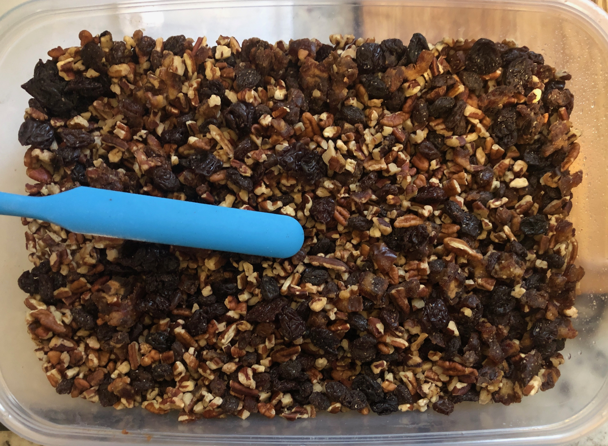

# Dried Fruit Cookies
Soft and moist cookies with a nutty crunch and fruity chew accented by aromatic spices
associated with cozy gatherings around a warm fire in cold weather.

## Notes
- Doubling not recommended as the size of the mix becomes difficult to fit in household mixers.
  > It makes a surprisingly large batch as-is, and these freeze well for weeks.
- Dates - Whole or Chopped - Definitely Pitted
  > I found the dates mix better if I chop them. You can also buy them chopped which also
  > lessens the odds of getting dates with overlooked pits remaining in them. The down
  > side to pre-chopped is that it's harder to find them so and not dusted with sugar.
  > I also recommend using a knife or easy to clean kitchen scissors instead of a cutting
  > with any fancy dicing tools as the dates like to stick to anything cutting them.
- Pecans - Chopped
  > Same goes for the pecans though they're much easier to find chopped without adulteration.
- Gluten Friendly
  > Previously used a [gluten friendly flour alternative](https://www.thekitchn.com/16-gluten-free-flour-alternatives-22943791)
  > that worked well but forgot to log it:
  > - Garbanzo/Chickpea flour worked.
  > - Almond flour might work?
  > - Coconut flour might be able to work but takes experience working with it and major adjustments to this recipe.
- Vegan Friendly
  > This adapts well for vegan folks:
  > - "Just Egg, Plant-Based Egg" - worked.
  > - Margarine - did well for butter.
  > - Oat Milk - worked well.
- Whiskey
  > Not sure if it makes a difference but since these are usually made around Thanksgiving
  > time I like to use Wild Turkey as the brand of whiskey.
- Brown Sugar
  > Though it's considerably more costly, I've been using brown coconut sugar as it has a
  > lower glycemic index and has a more subtle caramel-like flavor that better shares the
  > palate's stage with the other ingredients.

## Have Ready
### Dried Fruits & Nuts
>
- 2 pounds (4 1/2 cups) Pecans
- 1/2 lb (or more... roughly a touch less than 1 cup) each:
  - dates (not sweetened)
  - dried cherries (not sweetened)
  - raisins (plain dried)

### Spiced Cookie Flour Ingredients
In a large salad/serving bowl sift these together:
- 3 cups flour
- 2 1/2 teaspoons baking soda
- 2 teaspoons each:
  - cinnamon
  - nutmeg
- 1 teaspoon each:
  - ground cloves
  - ground ginger

### Cookie Wet Ingredients
Mix all of these together:
  > Mixer on slower settings works.
  > Since the other ingredients will be joining these - use a large bowl. Mixer sized bowl at smallest.
- 1/2 cup butter or margarine (1 stick)
- 1 cup packed brown sugar
- 4 eggs (preferably large)
- 3 tablespoons milk
- 1/2 cup whiskey

## Bringing It All Together
- Gradually mix in dry sifted ingredients to wet batter.
- Gradually mix in fruit and nuts.
- Bring it all to an even mix.

## The Bake
- Drop by teaspoonful, or ice scream scooper, on to greased cookie sheet. I now use parchment paper.
- Bake for 30 minutes @ 250 degrees.
